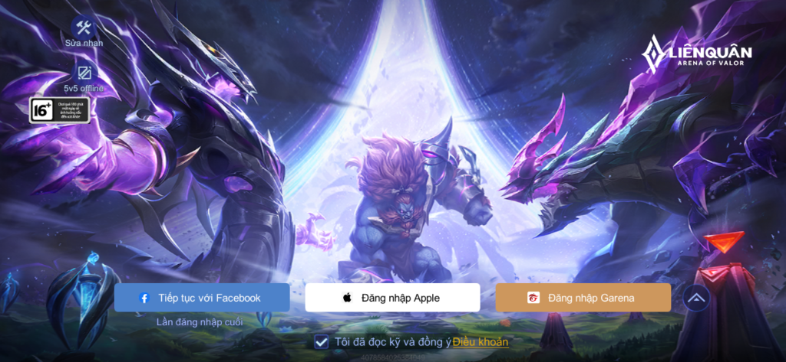

# Arena of Valor (Liên Quân Mobile) SDDM Theme

A production-quality custom SDDM greeter theme faithfully inspired by the Arena of Valor (Liên Quân Mobile) login interface, engineered for **Arch Linux**, **EndeavourOS**, and other Arch-based distributions with Wayland (Hyprland, KDE Plasma, GNOME, Niri) and X11 sessions.



---

## 1. Features

- **Visual Hierarchy**: Reproduces the composition of the Arena of Valor login screen with responsive scaling across 720p, 1080p, 1440p, 4K, and 21:9 ultrawide displays.
- **Dual Background System**:
  - **Animated Video Background**: Smooth looping H.264 video playback using Qt 6 QtMultimedia with FFmpeg backend.
  - **Static Image Background**: High-resolution artwork with instant fallback if video decoding or media plugins are absent.
  - **Ambient Parallax & Dimming**: Responsive mouse parallax effect and configurable dimming overlay for maximum contrast.
- **Persistent Account Quick Access**:
  - Remembers the last used local Linux account across greeter restarts and reboots using dedicated SQLite storage (`QtQuick.LocalStorage`).
  - Preselects the last active username on launch ("Lần đăng nhập cuối").
  - Account drawer allows fast switching between saved accounts and discovered system users.
  - One-click account removal/forget feature.
  - **Strict Security**: Passwords, PAM tokens, and sensitive authentication credentials are **never** logged, persisted, or written to disk.
- **Desktop Session Selector**:
  - Dynamically discovers all installed desktop sessions from SDDM (`/usr/share/wayland-sessions` and `/usr/share/xsessions`), including Hyprland, KDE Plasma, GNOME, LXQt, Openbox, etc.
  - Displays session names, descriptions, and vector icons.
  - Smooth animated transitions on open, close, item hover, and active selection.
  - Passes the selected session directly to SDDM greeter.
- **Top-Left Auxiliary Controls**:
  - **Sửa nhanh** (Quick Repair / Diagnostics): Displays display resolution, DPI, Wayland/X11 status, session count, user count, and provides safe greeter state reload and account cache clearing.
  - **5v5 offline** (Restricted Media Profile): Dedicated modal querying a restricted local account (`guest` or configured `offlineAccount`) designed exclusively for simple local media/YouTube viewing with strictly no terminal access, no shell commands, and no installation privileges.
  - **16+ Badge**: Configurable informational age-rating badge matching original game UI.
- **Top-Right Branding**:
  - High-resolution authentic Arena of Valor (Liên Quân Mobile) transparent emblem with dynamic aspect-ratio scaling and subtle celestial breathing glow (`assets/logos/origin_logo_hd.png`).
- **Bottom Login Composition (Origin Visual Match)**:
  - **Tiếp tục với Facebook (Blue Button, Left)**: Quick-login action for the preselected / remembered account with "Lần đăng nhập cuối" subtitle.
  - **Đăng nhập Apple (Center Button)**: Dedicated Sub UI querying and displaying only accounts with administrative `sudo` privileges (`wheel` group on Arch/EndeavourOS for `sudo pacman`), with an interactive new account registration wizard.
  - **Đăng nhập Garena (Gold Button, Right)**: Dedicated Sub UI querying standard local accounts (no `sudo` privileges, standard terminal/desktop usage), with a new standard account creation workflow.
  - **Options Drawer (Circular Button, Far Right)**: Single authoritative location for desktop environment switching ("Đổi môi trường đồ họa") and system power controls (Shutdown, Reboot, Suspend, Hibernate).
- **Strict Non-Empty Field Validation**:
  - Username and password fields cannot be submitted empty; empty submissions trigger an alert shake animation and inline status warning.
- **Single Session Switcher & Account Flow**:
  - Cleaned up duplicated controls: exactly one session selector in OptionsDrawer and dedicated role-based account selectors.
- **Terms & System Guidelines**:
  - Configurable checkbox row and clickable "Điều khoản" dialog detailing local security policy, keyboard shortcuts, and session info.

---

## 2. Directory Structure

```
aov_sddm/
├── metadata.desktop           # SDDM greeter theme metadata (QtVersion=6, Theme-API=2.0)
├── Main.qml                   # Primary QML root composition
├── theme.conf                 # Centralized user-editable theme configuration
├── components/                # Modular UI components
│   ├── ActionButton.qml       # Game-styled responsive buttons
│   ├── AccountSelector.qml    # Remembered accounts manager modal
│   ├── AppleAuthModal.qml     # Sub UI for sudo accounts (wheel / sudo pacman)
│   ├── Background.qml         # Video/Image background with fallback & parallax
│   ├── BrandLogo.qml          # Dynamic aspect ratio logo with breathing glow
│   ├── DiagnosticsModal.qml   # Safe diagnostics modal ("Sửa nhanh")
│   ├── GarenaAuthModal.qml    # Sub UI for standard accounts (no sudo)
│   ├── LoginForm.qml          # Password entry, non-empty validation & error display
│   ├── OfflineAuthModal.qml   # Sub UI for 5v5 offline restricted profile
│   ├── OptionsDrawer.qml      # Single authoritative session & power drawer
│   ├── Persistence.qml        # SQLite account persistence, roles & validation
│   ├── SessionSelector.qml    # Animated desktop environment selector
│   ├── TermsModal.qml         # Terms & hotkeys guide modal
│   ├── ThemeStyles.qml        # Color palette & animation metrics
│   └── TopLeftControls.qml    # Top-left action controls & 16+ badge
├── assets/                    # Theme assets
│   ├── backgrounds/           # default.png, default.mp4, screenshot_reference.png
│   ├── logos/                 # origin_logo_hd.png, aov_logo.svg, aov_crest.svg
│   ├── icons/                 # Vector SVG icons (sessions, actions, power)
│   └── fonts/                 # Orbitron-Bold.ttf
├── scripts/
│   ├── install.sh             # Idempotent Arch/EndeavourOS installer
│   ├── uninstall.sh           # Safe uninstaller & system recovery
│   └── test-greeter.sh        # Preview greeter locally without logout
├── tests/                     # Validation test suite
│   ├── run_all_tests.sh       # Master test runner
│   ├── test_syntax.sh         # qmllint & bash -n validation
│   ├── test_config.sh         # Metadata, theme.conf, and asset checks
│   ├── test_persistence.sh    # Storage validation and security tests
│   └── test_installer.sh      # Dry-run, idempotency, and cleanup tests
├── install.sh -> scripts/install.sh
├── uninstall.sh -> scripts/uninstall.sh
└── README.md
```

---

## 3. Dependencies

The theme uses Qt 6 and is optimized for modern SDDM releases (`sddm >= 0.20.0`).

### Required Packages:
- `sddm`
- `qt6-declarative`
- `qt6-svg`
- `qt6-5compat`

### Optional Packages (for Animated Video Background):
- `qt6-multimedia`
- `qt6-multimedia-ffmpeg`

*Note: If multimedia packages are omitted or uninstalled, the theme automatically falls back to the static image background without any errors.*

---

## 4. Quick Preview (Test Mode)

You can launch and interact with the SDDM greeter directly in a window on your current desktop session without logging out or restarting display services:

```bash
./scripts/test-greeter.sh
```

Or using `sddm-greeter-qt6` directly:

```bash
sddm-greeter-qt6 --test-mode --theme "$PWD"
```

---

## 5. Installation

### Standard Installation (Sets as default automatically):
To install the theme to `/usr/share/sddm/themes/aov-sddm` and set it as the default theme:

```bash
sudo ./install.sh
```

*(Note: Automatically sets `Current=aov-sddm` in `/etc/sddm.conf.d/99-aov-theme.conf` and synchronizes `/etc/sddm.conf` to satisfy SDDM config precedence).*

### Install Without Setting as Default:
```bash
sudo ./install.sh --no-set-default
```

### Dry-Run Mode:
Inspect what the installer will do without modifying any files or packages:

```bash
./install.sh --dry-run
```

### Static Background Only (No Video Dependencies):
```bash
sudo ./install.sh --static-only
```

### Custom Theme Destination:
```bash
sudo ./scripts/install.sh --theme-dir /usr/share/sddm/themes/my-custom-theme
```

---

## 6. Configuration Guide (`theme.conf`)

You can customize the theme behavior by modifying `/usr/share/sddm/themes/aov-sddm/theme.conf`:

```ini
[General]
# Background mode: "video" (default) or "image"
backgroundType=video
background=assets/backgrounds/default.png
videoBackground=assets/backgrounds/default.mp4
dimOverlay=0.20
enableParallax=true
reducedMotion=false

# Virtual Keyboard (auto-popup suppressed by default)
enableVirtualKeyboard=false

# Branding
showLogo=true
logo=assets/logos/origin_logo.png
logoWidth=230
logoScale=1.0

# Top-Left Actions
showTopLeftControls=true
showAgeRating=true
textRepair=Sửa nhanh
textAuxiliary=5v5 offline

# Bottom Buttons & Account Roles
textQuickLoginPrefix=Tiếp tục với 
textLastLoginSubtitle=Lần đăng nhập cuối
sudoAccounts=loliconhihi,duckneee,bocuawin0608,dotfile-test
offlineAccount=guest

# Terms Row
showTerms=true
termsText=Tôi đã đọc kỹ và đồng ý 
termsLinkText=Điều khoản
termsRequired=false
```

### Changing Background Video or Image:

You can easily insert and configure any custom background video or image using the provided helper script:

```bash
# Set any custom video file:
./set-video.sh ~/Videos/my_aov_background.mp4

# Preview immediately:
./set-video.sh ~/Videos/my_aov_background.mp4 --preview

# Deploy directly to the installed system theme:
sudo ./set-video.sh ~/Videos/my_aov_background.mp4
```

Supported video formats: `.mp4`, `.webm`, `.mkv`, `.avi`, `.mov` (H.264, VP8/VP9, AV1, HEVC). All background videos play with audio muted by default to preserve a calm login experience.

### Virtual Keyboard Behavior:

- **Auto-Popup Disabled**: Unlike default EndeavourOS behavior where `qtvirtualkeyboard` pops up automatically on boot or focus, the theme completely suppresses auto-popups at both the QML input method layer and the SDDM configuration layer (`InputMethod=` in `zz-aov-theme.conf` and `/etc/sddm.conf`).
- **On-Demand Activation**: A clean keyboard icon button is available directly on the password input field. Clicking it toggles the virtual keyboard on demand when you actually need it.

---

## 7. Keyboard Navigation & Shortcuts

| Key / Shortcut | Function |
| :--- | :--- |
| `Tab` / `Shift+Tab` | Navigate between username field, password field, and buttons |
| `Enter` / `Return` | Submit login credentials or activate focused button |
| `Esc` | Close any open modal dialog (Session Selector, Account Drawer, Diagnostics, Terms) |
| `Up` / `Down` | Navigate through desktop sessions in the Session Selector |

---

## 8. Uninstallation & Recovery

To safely remove the theme and restore previous SDDM configuration:

```bash
sudo ./scripts/uninstall.sh
```

### Purging Cached Account History:
To remove the theme and clear the remembered username cache:

```bash
sudo ./scripts/uninstall.sh --purge-data
```

### Manual Display Manager Recovery:
If you ever need to manually switch SDDM back to your distribution's default theme (e.g. `eos-breeze` or `breeze`):

```bash
# Verify current setting:
grep -rn "Current=" /etc/sddm.conf.d/ /etc/sddm.conf

# Revert to default theme:
echo -e "[Theme]\nCurrent=eos-breeze" | sudo tee /etc/sddm.conf.d/10-theme.conf
```

The installer never touches active display manager services, never modifies unrelated user files, and never initiates an automatic reboot.

---

## 9. Running Automated Tests

Run the full automated test suite:

```bash
./tests/run_all_tests.sh
```

Tests include:
- `test_syntax.sh`: `qmllint` syntax check on all QML files and `bash -n` on shell scripts.
- `test_config.sh`: Validates metadata keys, `theme.conf` fields, and verifies that all 25+ referenced vector assets exist.
- `test_persistence.sh`: Automated QML test harness verifying username regex validation (safe characters, rejecting path traversal or shell characters), account saving, preselection, and removal.
- `test_installer.sh`: Verifies dry-run execution, custom path isolation, and installation idempotency.
- Live greeter preview validation via `sddm-greeter-qt6 --test-mode`.

---

## 10. License

Theme code and vector assets are licensed under the [MIT License](LICENSE).
The visual layout is inspired by Arena of Valor (Liên Quân Mobile).

